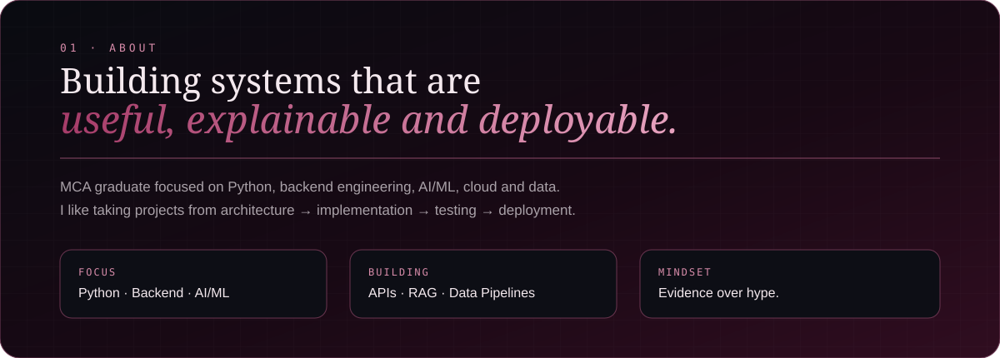

<a href="https://github.com/shyamprakash534">GitHub</a> · <a href="https://www.linkedin.com/in/shyam-prakash-vemula-721029263/">LinkedIn</a> · <a href="https://syam-prakash-portfolio-live.onrender.com">Portfolio</a> · <a href="mailto:shyamprakash271@gmail.com">Email</a>

---

## 👋 A little more context

I’m an **MCA graduate** building practical software across **Python, backend engineering, AI/ML, GenAI, cloud and data**. I care about the part after the demo: testing, deployment, security, observability and maintainability.

**Currently open to:** Software Engineer · Python Developer · Backend Developer · AI/ML Engineer · GenAI Developer · Data Analyst · Data Engineer · Cloud/DevOps roles.

**Preferred:** Hyderabad · Bengaluru · India · Remote · Entry-level / 0–1 year.

---

### Project links

| Project | What it demonstrates |
|---|---|
| [**CodeForge**](https://github.com/shyamprakash534/Codeforge) | Multi-agent software engineering, testing, repair, security and human approval |
| [**NanoLink**](https://github.com/shyamprakash534/nanolink1) | Distributed systems, caching, rate limiting and asynchronous analytics |
| [**Grounded RAG**](https://github.com/shyamprakash534/grounded-rag) | Retrieval-augmented generation and source-grounded responses |
| [**AWS E-Commerce Data Pipeline**](https://github.com/shyamprakash534/aws-ecommerce-data-pipeline) | AWS data engineering, PySpark, SQL and infrastructure as code |
| [**JobMatch AI**](https://github.com/shyamprakash534/ai-job-application-tracker) | Resume parsing, structured extraction and weighted job matching |
| [**AI Drug Recommendation**](https://github.com/shyamprakash534/drug-recommendation) | End-to-end ML application and model explainability |

---

## 🧰 Core stack

**Languages:** Python · Go · SQL · JavaScript  
**AI/ML:** Scikit-learn · Random Forest · Gradient Boosting · SHAP · RAG · LangGraph · Ollama · ChromaDB  
**Backend:** FastAPI · Flask · Gin · REST APIs  
**Data:** Pandas · NumPy · MySQL · PostgreSQL · AWS Glue · Athena · ETL  
**Cloud:** AWS S3 · EC2 · Lambda · RDS · IAM · CloudWatch · Boto3  
**Engineering:** Docker · Terraform · GitHub Actions · Redis · ClickHouse · Git

---

## 🎓 Education

**Master of Computer Applications (MCA)** — Vignan's Lara Institute of Technology and Science  
**B.Sc. Statistics** — Acharya Nagarjuna University

---

## 📈 A year of building

> **Evidence over hype.** I prefer real repositories, working deployments, reproducible workflows and honest engineering trade-offs over inflated numbers.

---

## 🔭 Currently focused on

**Python backend engineering · AI/ML · GenAI applications · AWS/cloud · data engineering**

## 🤝 Let’s build something worth explaining.

**[GitHub](https://github.com/shyamprakash534) · [LinkedIn](https://www.linkedin.com/in/shyam-prakash-vemula-721029263/) · [Portfolio](https://syam-prakash-portfolio-live.onrender.com) · [Email](mailto:shyamprakash271@gmail.com)**

