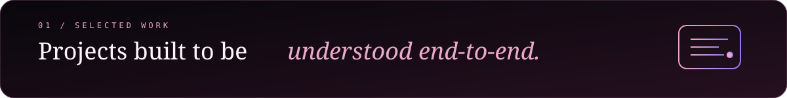
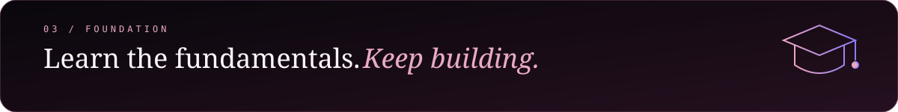
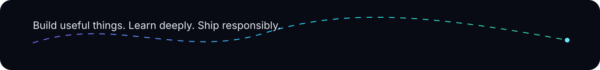

### **Software Developer · Python · Backend · AI/ML · Cloud · Data**

> **Building practical software across Python, backend systems, AI/ML, GenAI, AWS and data engineering.**

---

<table>
<tr>
<td align="center" width="25%"><b>🎓 MCA</b> Graduate · 2026</td>
<td align="center" width="25%"><b>🐍 Python</b> Backend & AI</td>
<td align="center" width="25%"><b>☁️ AWS</b> Cloud & Data</td>
<td align="center" width="25%"><b>🚀 Focus</b> Build · Ship · Learn</td>
</tr>
</table>

## 👋 About me

I’m **Vemula Syam Prakash**, an MCA graduate who enjoys turning ideas into working software — from APIs and distributed services to ML systems, RAG applications and cloud data pipelines.

I focus on the details that make projects useful beyond a demo: **architecture, APIs, data flow, testing, deployment, observability and clear documentation.**

**Open to:** Software Engineer · Python Developer · Backend Developer · AI/ML / GenAI Developer · Data Analyst · Data Engineer · Cloud/DevOps

📍 Hyderabad · Bengaluru · India · Remote

---

## ⭐ Selected work

<table>
<tr>
<td width="50%" valign="top">

### 🤖 CodeForge
**Agentic Software Engineering**

Multi-agent workflow for software tasks, testing, repair, security checks and human approval.

`Python` `LangGraph` `FastAPI` `Docker`

<a href="https://github.com/shyamprakash534/Codeforge">View repository →</a>

</td>
<td width="50%" valign="top">

### ⚡ NanoLink
**Distributed Backend System**

Production-minded URL shortener exploring caching, rate limiting, persistence and asynchronous analytics.

`Go` `Redis` `PostgreSQL` `ClickHouse`

<a href="https://github.com/shyamprakash534/nanolink1">View repository →</a>

</td>
</tr>
<tr>
<td width="50%" valign="top">

### 🧠 Grounded RAG
**Source-Grounded GenAI**

Local-first RAG application designed to retrieve relevant context and generate source-backed responses.

`Python` `FastAPI` `ChromaDB` `Ollama`

<a href="https://github.com/shyamprakash534/grounded-rag">View repository →</a>

</td>
<td width="50%" valign="top">

### ☁️ AWS E-Commerce Pipeline
**Cloud Data Engineering**

Raw-to-curated data workflow combining AWS services, PySpark, SQL and infrastructure as code.

`AWS` `Glue` `Athena` `PySpark` `Terraform`

<a href="https://github.com/shyamprakash534/aws-ecommerce-data-pipeline">View repository →</a>

</td>
</tr>
</table>

### 🔎 More projects

| Project | What it demonstrates |
|---|---|
| **[JobMatch AI](https://github.com/shyamprakash534/ai-job-application-tracker)** | Resume parsing · structured extraction · weighted job matching |
| **[AI Drug Recommendation](https://github.com/shyamprakash534/drug-recommendation)** | Ensemble ML · explainability · Flask deployment · live application |

---

## 🧰 Technical toolkit

  

<table>
<tr><td><b>Languages</b></td><td>Python · Go · SQL · JavaScript</td></tr>
<tr><td><b>AI / GenAI</b></td><td>scikit-learn · SHAP · RAG · LangGraph · Ollama · ChromaDB</td></tr>
<tr><td><b>Backend</b></td><td>FastAPI · Flask · Gin · REST APIs</td></tr>
<tr><td><b>Data</b></td><td>Pandas · NumPy · PostgreSQL · MySQL · Redis · ClickHouse · ETL · PySpark</td></tr>
<tr><td><b>AWS</b></td><td>S3 · EC2 · Lambda · RDS · IAM · CloudWatch · Boto3 · Glue · Athena</td></tr>
<tr><td><b>Engineering</b></td><td>Docker · Terraform · GitHub Actions · Git · Testing · Deployment</td></tr>
</table>

---

## 🎓 Education & credentials

<table>
<tr>
<td width="50%" valign="top">

**Master of Computer Applications**  
Vignan’s Lara Institute of Technology and Science · **2026**

**B.Sc. Statistics**  
Acharya Nagarjuna University

</td>
<td width="50%" valign="top">

🏅 **Google AI Professional Certificate**  
☁️ **AWS Certified Cloud Practitioner — CLF-C02**  
🤖 **Oracle Agentic AI Foundations Associate**

</td>
</tr>
</table>

---

## 📈 GitHub activity

---

## 🎯 What I’m focused on

`PYTHON BACKEND`　 `AI / ML`　 `GENAI`　 `AWS / CLOUD`　 `DATA ENGINEERING`

I’m going deeper into **production-minded Python, grounded GenAI, AWS/data workflows, testing and reliable software engineering.**

> 💡 **Evidence over hype.** Real repositories. Explainable decisions. Reproducible workflows. Honest trade-offs.

---

## 🚀 Let’s build something useful

  

